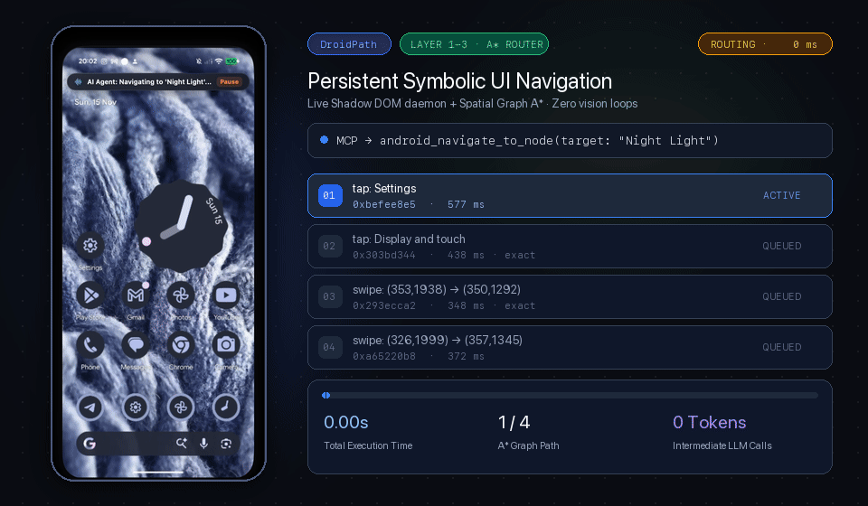
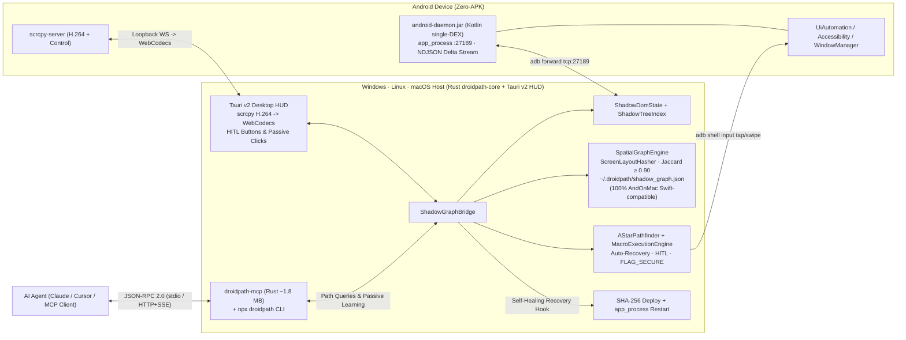
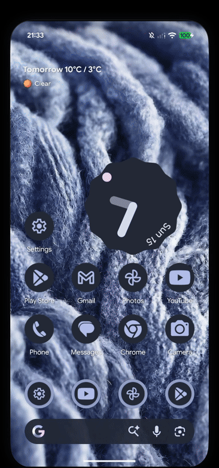

# DroidPath

**Cross-Platform Persistent A\* Symbolic UI Router, Headless Kotlin Shadow DOM Daemon, Native Rust MCP CLI & Tauri v2 Agentic HUD for Android (Windows · Linux · macOS)**

[](./LICENSE)
[](https://github.com/V0val0x/DroidPath)
[](https://github.com/V0val0x/DroidPath/releases)
[](https://github.com/V0val0x/DroidPath/actions/workflows/ci.yml)

**English** | [Русская версия (Russian)](README_RU.md)



**DroidPath** eliminates slow, token-heavy VLM screenshot-think-tap loops for Android automation. Instead of asking an LLM to inspect screenshots at every step, DroidPath streams a live **Shadow DOM** directly from Android Accessibility & Window APIs, compiles UI transitions into a **persistent Spatial Graph**, and navigates multi-screen workflows deterministically with **A\* pathfinding** in sub-second hops — with **zero intermediate LLM roundtrips**.

Now powered by a **zero-JVM cross-platform Rust core (`droidpath-core`)**, a **~1.8 MB native MCP CLI (`droidpath-mcp`)**, a **Tauri v2 Desktop HUD (`~3.9 MB`)** with built-in H.264 WebCodecs mirroring (Windows, Linux Wayland/X11, macOS), and **1-click Zero-Friction Onboarding** (`npx droidpath` / `install.sh` / `install.ps1`). Fully **100% `shadow_graph.json` compatible** with native macOS [**AndOnMac**](https://github.com/V0val0x/AndOnMac).

---

## 1-Click Zero-Friction Onboarding

### Option A: `npx droidpath` (Windows · Linux · macOS)

Bundles `android-daemon.jar` directly inside the CLI package — auto-pushes via SHA-256 cached `adb push`, configures `adb forward`, starts `app_process`, and auto-configures Cursor / Claude Desktop MCP:

```bash
# 1-click daemon deploy + Cursor/Claude MCP auto-configuration
npx droidpath start --configure

# Or run individual commands:
npx droidpath init --client all       # Auto-configure Cursor & Claude Desktop MCP JSON
npx droidpath daemon deploy           # SHA-256 cached adb push + adb forward + app_process
npx droidpath mcp --stdio             # Launch native Rust MCP server (auto-injects daemon)
npx droidpath doctor                  # Full environment & device health check
```

### Option B: Zero-Node.js Native Installers (`install.sh` / `install.ps1`)

**macOS & Linux:**
```bash
curl -fsSL https://raw.githubusercontent.com/V0val0x/DroidPath/main/scripts/install.sh | bash -s -- --deploy --configure-mcp all
```

**Windows (PowerShell):**
```powershell
irm https://raw.githubusercontent.com/V0val0x/DroidPath/main/scripts/install.ps1 | iex
# Or with local options:
.\scripts\install.ps1 -Deploy -ConfigureMcp all
```

---

## Architecture (3 Layers · Cross-Platform)



1. **Layer 1 — Headless Kotlin Shadow DOM Daemon (`android-daemon/`):**
   - Compiles into a standalone **650 KB single-DEX JAR** (`android-daemon.jar`) launched via `app_process` — zero companion APK install required.
   - Streams full snapshots, compact NDJSON incremental diffs, foreground `TYPE_APPLICATION` window priority over `com.android.systemui` notifications, and `SECURE_SCREEN_ACTIVE` / `SECURE_SCREEN_CLEARED` events on `FLAG_SECURE` or biometric prompts over TCP (`:27189`).
   - Deployed idempotently via SHA-256 verification and protected by automatic self-healing recovery.

2. **Layer 2 — Cross-Platform Rust Core (`crates/droidpath-core`):**
   - Bit-exact FNV-1a 64-bit `ScreenLayoutHasher` stripping volatile clocks, dates, e-commerce tokens (`<PRICE>`, `<ETA>`, `<WEIGHT>`), unanchored decorative banner `ImageView`s, and `com.android.systemui` notification overlays.
   - `SpatialGraphEngine` builds a directed multigraph with automatic Jaccard (`>= 0.90`) compaction, hazardous edge classification (`HazardousActionClassifier`), acyclic spanning DAG rebuild, and **100% bidirectional `shadow_graph.json` compatibility** with Swift `AndOnMac`.

3. **Layer 3 — Persistent A\* Router, MCP CLI (`crates/droidpath-mcp`) & Tauri v2 Desktop HUD (`apps/droidpath-desktop`):**
   - `AStarPathfinder` + `MacroExecutionEngine` with forward-skip recovery (`1 -> 3/4`), off-path scroll replan, universal popup dismissal (`UniversalDismissDetector`), reflexive heads-up notification swipe-up, Human-in-the-Loop confirmation (`requires_confirmation` / `confirmed: true`) before irreversible payment/destructive steps, and `FLAG_SECURE` biometric handoff (60s default wait).
   - **Tauri v2 Desktop HUD** combines an embedded `scrcpy-server` H.264 -> WebCodecs `<canvas>` mirror (with automatic `screencap` fallback) and an integrated 3-color **Agentic HUD** (**Red** autonomous execution, **Yellow** awaiting HITL confirmation with interactive *Approve / Cancel* buttons, **Blue** awaiting biometrics / `FLAG_SECURE`) + live SVG Spatial Graph Explorer in a single window — working cleanly on **Windows, macOS, and Linux Wayland/X11** while preserving passive graph learning by clicking.

---

## Live Benchmark (Pixel 10a · `android_navigate_to_node`)

Prompt: *"Navigate to Night Light"* from Launcher Home Screen:

| Metric | Traditional VLM Screenshot Loop | **DroidPath A\* Router** |
| :--- | :---: | :---: |
| **Intermediate LLM Roundtrips** | 4–5 vision inference calls | **0 calls** |
| **Total End-to-End Latency** | ~12,000–25,000 ms | **1,683 ms** (4 hops) |
| **State Feedback** | Full PNG screenshots (`screencap`) | Sub-ms Shadow DOM NDJSON frames |

| Agentic HUD Execution |
| :---: |
|  |

## Comparison with Alternatives

Existing solutions rely on stateless ADB bindings, adding 2–4 seconds of latency per action and forcing the LLM to micromanage the UI step by step. DroidPath (and [AndOnMac](https://github.com/V0val0x/AndOnMac)) uses a persistent Directed Acyclic Graph (DAG) and A* routing across Windows, Linux, and macOS, cutting latency to `<1s` per click and removing LLM overhead on known routes.

| Tool | UI & Automation Model | Latency / Action | LLM Overhead | Mirroring & HUD |
| :--- | :--- | :---: | :--- | :--- |
| **Mobile MCP / Maestro MCP / adbridge** | Stateless ADB / `uiautomator` wrappers | 2–4 s | LLM plans every tap/scroll | None |
| **Appium / CursorTouch** | WebDriver sessions or screenshot/coordinate loops | 2–5 s | Heavy screenshot / selector polling | External / VNC |
| **DroidPath (Rust + Tauri v2 / AndOnMac)** | Persistent DAG + A\* router + live Shadow DOM daemon | `<1s` / hop | `0` intermediate calls on known routes | Tauri v2 WebCodecs / 120Hz Metal + 3-color HUD |

---

## Building from Source

Prerequisites: Rust (`stable`), `adb` (Android Platform Tools), Node.js 18+ (for CLI / Tauri frontend), JDK 17 (only if rebuilding `android-daemon.jar`).

```bash
git clone https://github.com/V0val0x/DroidPath.git
cd DroidPath

# 1. Run all Rust core + MCP integration tests
cargo test -p droidpath-core -p droidpath-mcp

# 2. Build optimized native droidpath-mcp binary (~1.8 MB, zero JVM)
cargo build --release -p droidpath-mcp

# 3. Run Node.js 1-click CLI tests
npm --prefix packages/droidpath-cli test

# 4. Build & launch cross-platform Tauri v2 Desktop HUD
cd apps/droidpath-desktop
npm install
npm run tauri dev      # or: npm run tauri build

# 5. (Optional) Rebuild Kotlin single-DEX android-daemon.jar
./android-daemon/scripts/build-dex.sh
npm --prefix packages/droidpath-cli run sync-daemon
```

---

## Exposed MCP Tools

| Tool | Description |
| :--- | :--- |
| `android_navigate_to_node` | Runs Layer 3 A\* routing to reach a target text, `resource-id`, package, or canonical layout hash (`0x...`) across screens (supports `confirmed: true` for HITL) |
| `android_get_ui_tree` | Reads live interactive UI elements from the Kotlin Shadow DOM stream (with `uiautomator` XML fallback) |
| `android_graph_stats` | Inspects persisted graph vertex/edge counts, active canonical hash, daemon state, and storage path |
| `android_list_devices` | Lists connected USB and Wireless ADB Android devices |
| `android_tap_element` | Taps by `(x, y)` or semantic `text` / `resource_id` / `content_desc` and records the graph edge |
| `android_swipe` | Swipes `(x1, y1) -> (x2, y2)` and attributes the gesture into the Spatial Graph |
| `android_type_text` | Types ASCII or Unicode text into the active Android field |
| `android_keyevent` | Sends Android keyevents (`HOME`, `BACK`, `ENTER`, `APP_SWITCH`, `POWER`) |

---

## Ecosystem & macOS Native Companion

- [**AndOnMac**](https://github.com/V0val0x/AndOnMac) — Native macOS 120Hz ProMotion VideoToolbox + Metal Android mirroring app with Swift `AndroidShadowGraphKit` (100% `shadow_graph.json` compatible with cross-platform DroidPath)

## License

MIT License © 2026 Kirill Zaitsev. See [LICENSE](./LICENSE).
