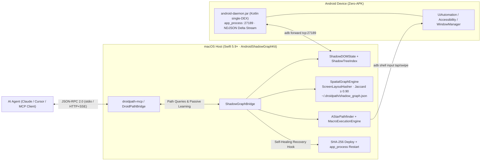

# DroidPath

**Persistent A\* Symbolic UI Router, Headless Kotlin Shadow DOM Daemon & Standalone MCP Bridge for Android**

[](./LICENSE)
[](https://github.com/V0val0x/DroidPath)
[](https://github.com/V0val0x/DroidPath/releases)
[](https://github.com/V0val0x/DroidPath/actions/workflows/ci.yml)

**English** | [Русская версия (Russian)](README_RU.md)


**DroidPath** eliminates slow, token-heavy VLM screenshot-think-tap loops for Android automation. Instead of asking an LLM to inspect screenshots at every step, DroidPath streams a live **Shadow DOM** directly from Android Accessibility & Window APIs, compiles UI transitions into a **persistent Spatial Graph**, and navigates multi-screen workflows deterministically with **A\* pathfinding** in sub-second hops — with **zero intermediate LLM roundtrips**.

---

## Architecture (3 Layers)



1. **Layer 1 — Headless Kotlin Shadow DOM Daemon (`android-daemon/`):**
   - Compiles into a standalone **631 KB single-DEX JAR** (`android-daemon.jar`) launched via `app_process` — zero companion APK install required.
   - Streams full snapshots and compact NDJSON incremental diffs over TCP (`:27189`) with event debouncing, configurable tree depth, and heartbeat/watchdog protection.
   - Deployed idempotently via SHA-256 verification (`DroidPathManager` / `deploy.sh`) and protected by automatic self-healing recovery if Android kills the process.

2. **Layer 2 — Live Shadow DOM & Persistent Spatial Graph (`AndroidShadowGraphKit`):**
   - `ScreenLayoutHasher` strips volatile timestamps, clocks (`12:34`), and dates so returning to Home or Settings hashes deterministically.
   - `SpatialGraphEngine` constructs a directed multigraph of screens (`vertices`) and UI gestures (`edges`), automatically compacts near-duplicate screens via Jaccard similarity (`>= 0.90`), and persists to `~/.droidpath/shadow_graph.json`.

3. **Layer 3 — Persistent A\* Symbolic Router & Standalone MCP Bridge (`DroidPathBridge` + `droidpath-mcp`):**
   - `AStarPathfinder` + `BinaryHeapPriorityQueue` computes minimum-cost multi-hop routes to any target text, `resource-id`, package, or canonical layout hash.
   - `MacroExecutionEngine` dispatches each tap/swipe over ADB, waits for exact or canonical Shadow DOM confirmation per hop (including post-swipe `RecyclerView` fling quiescence before resolving downstream bounds), and raises structured `PathDeviationError` diagnostics on unexpected popups or screen timeouts.

---

## Live Benchmark (Pixel 10a · `android_navigate_to_node`)

Prompt: *"Navigate to Night Light"* from Launcher Home Screen:

| Metric | Traditional VLM Screenshot Loop | **DroidPath A\* Router** |
| :--- | :---: | :---: |
| **Intermediate LLM Roundtrips** | 4–5 vision inference calls | **0 calls** |
| **Total End-to-End Latency** | ~12,000–25,000 ms | **1,683 ms** (4 hops) |
| **State Feedback** | Full PNG screenshots (`screencap`) | Sub-ms Shadow DOM NDJSON frames |

| Standalone Agentic HUD Execution |
| :---: |
|  |

---

## Quick Start

### 1. Build `droidpath-mcp` & `android-daemon.jar`

Prerequisites: macOS 14+, Swift 5.9+, `adb` (`brew install android-platform-tools`), JDK 17 (only needed if rebuilding `android-daemon.jar` from Kotlin source).

```bash
git clone https://github.com/V0val0x/DroidPath.git
cd DroidPath

# Build standalone single-DEX Kotlin daemon (requires JDK 17 + Android d8 / build-tools or Gradle)
./android-daemon/scripts/build-dex.sh

# Run Swift + Kotlin tests
swift test
./android-daemon/gradlew -p android-daemon test

# Build release CLI
swift build -c release
```

Or download prebuilt `droidpath-mcp` and `android-daemon.jar` directly from [**GitHub Releases**](https://github.com/V0val0x/DroidPath/releases).

### 2. Configure Claude Desktop / Cursor (`stdio`)

```json
{
  "mcpServers": {
    "droidpath": {
      "command": "/path/to/droidpath-mcp",
      "args": ["--stdio", "--daemon-jar", "/path/to/android-daemon.jar"]
    }
  }
}
```

Or launch the loopback HTTP/SSE MCP server (`127.0.0.1:8766`):

```bash
droidpath-mcp --http --port 8766 --daemon-jar ./android-daemon/build/dist/android-daemon.jar
```

### 3. Use `AndroidShadowGraphKit` in Swift Package Manager

```swift
dependencies: [
    .package(url: "https://github.com/V0val0x/DroidPath.git", from: "1.0.0")
]
```

Add `"AndroidShadowGraphKit"` (core Shadow DOM, Spatial Graph, and A\* engine) or `"DroidPathBridge"` (ADB deployer, persistence, and MCP core) to your target dependencies.

---

## Exposed MCP Tools

| Tool | Description |
| :--- | :--- |
| `android_navigate_to_node` | Runs Layer 3 A\* routing to reach a target text, `resource-id`, package, or canonical layout hash (`0x...`) across screens |
| `android_get_ui_tree` | Reads live interactive UI elements from the Kotlin Shadow DOM stream (with `uiautomator` XML fallback) |
| `android_graph_stats` | Inspects persisted graph vertex/edge counts, active canonical hash, daemon state, and storage path |
| `android_list_devices` | Lists connected USB and Wireless ADB Android devices |
| `android_tap_element` | Taps by `(x, y)` or semantic `text` / `resource_id` / `content_desc` and records the graph edge |
| `android_swipe` | Swipes `(x1, y1) -> (x2, y2)` and attributes the gesture into the Spatial Graph |
| `android_type_text` | Types text into the active Android field |
| `android_keyevent` | Sends Android keyevents (`HOME`, `BACK`, `ENTER`, `APP_SWITCH`, `POWER`) |

---

## Modular Open-Source Ecosystem

Part of the native macOS ↔ Android automation suite alongside [**AndOnMac**](https://github.com/V0val0x/AndOnMac):

- [**AndOnMac**](https://github.com/V0val0x/AndOnMac) — Native 120Hz ProMotion Metal Android mirroring & control app with built-in DroidPath Agentic HUD
- [**AndroidMCPKit**](https://github.com/V0val0x/AndroidMCPKit) — Visual-to-MCP `{{parameter}}` macro studio & 3-tier Apple Vision OCR self-healing
- [**MetalScrcpyKit**](https://github.com/V0val0x/MetalScrcpyKit) — Zero-copy VideoToolbox H.264/HEVC decoder & `CAMetalLayer` renderer
- [**ADBConnectKit**](https://github.com/V0val0x/ADBConnectKit) — Zero-dependency Swift ADB SDK (USB, QR Wi-Fi pairing, Direct Hotspot bypass)
- [**VisionScreenRecallKit**](https://github.com/V0val0x/VisionScreenRecallKit) — Apple Silicon Vision OCR & SQLite FTS5 screen memory

---

## License

MIT License © 2026 Kirill Zaitsev. See [LICENSE](./LICENSE).
