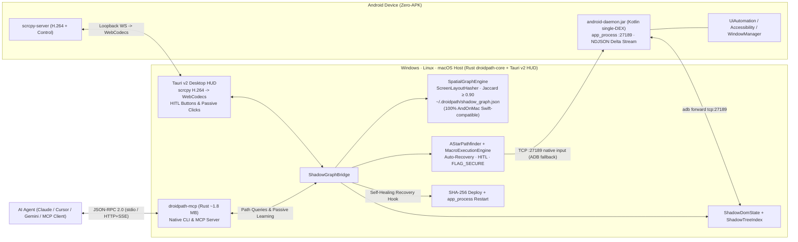

# DroidPath
<!-- mcp-name: io.github.V0val0x/droidpath -->

**Cross-Platform Persistent A\* Symbolic UI Router, Headless Kotlin Shadow DOM Daemon, Native Rust MCP CLI & Tauri v2 Agentic HUD for Android (Windows · Linux · macOS)**

[](./LICENSE)
[](https://github.com/V0val0x/DroidPath)
[](https://github.com/V0val0x/DroidPath/releases)
[](https://github.com/V0val0x/DroidPath/actions/workflows/ci.yml)

**English** | [Русская версия (Russian)](README_RU.md) · [Security Policy](SECURITY.md) · [Changelog](CHANGELOG.md)


**DroidPath** eliminates slow, token-heavy VLM screenshot-think-tap loops for Android automation. Instead of asking an LLM to inspect screenshots at every step, DroidPath streams a live **Shadow DOM** directly from Android Accessibility & Window APIs, compiles UI transitions into a **persistent Spatial Graph**, and navigates multi-screen workflows deterministically with **A\* pathfinding** in sub-second hops — with **zero intermediate LLM roundtrips**.

Powered by a **zero-JVM cross-platform Rust core (`droidpath-core`)**, a **~1.8 MB native MCP CLI (`droidpath-mcp`)**, a **Tauri v2 Desktop HUD (`~3.9 MB`)** with built-in H.264 WebCodecs mirroring (Windows, Linux Wayland/X11, macOS), and **1-click SHA-256 verified native installers** (`install.sh` / `install.ps1`). Fully **100% `shadow_graph.json` compatible** with native macOS [**AndOnMac**](https://github.com/V0val0x/AndOnMac).

---

## Prerequisites

- **Android 8.0+ (API 26+)** device with **USB Debugging** or **Wireless Debugging** enabled (no companion APK install and no root required).
- **Android Platform Tools (`adb`)** installed on the host:
  - **macOS:** `brew install android-platform-tools`
  - **Windows:** `winget install Google.PlatformTools`
  - **Linux (Debian/Ubuntu):** `sudo apt install adb`

---

## Quick Start (1-Click Native Installation)

### Option A: Native Installers (`install.sh` / `install.ps1` — Recommended, Zero Node.js Required)

Downloads the prebuilt native `droidpath-mcp` binary and `android-daemon.jar` directly from [GitHub Releases](https://github.com/V0val0x/DroidPath/releases), pins the release tag across CDN redirects, verifies **SHA-256** against `checksums.txt` fail-closed, deploys the daemon over ADB, and auto-configures your MCP clients (`cursor`, `claude`, `gemini`, `antigravity`, or `all`):

**macOS & Linux:**
```bash
curl -fsSL https://raw.githubusercontent.com/V0val0x/DroidPath/main/scripts/install.sh | bash -s -- --deploy --configure-mcp all
```

**Windows (PowerShell):**
```powershell
# Install droidpath-mcp.exe + android-daemon.jar and add ~/.droidpath/bin to User PATH:
irm https://raw.githubusercontent.com/V0val0x/DroidPath/main/scripts/install.ps1 | iex

# Install + deploy daemon + auto-configure Cursor, Claude Desktop, Gemini CLI & Antigravity:
$env:DROIDPATH_DEPLOY="1"; $env:DROIDPATH_CONFIGURE_MCP="all"; irm https://raw.githubusercontent.com/V0val0x/DroidPath/main/scripts/install.ps1 | iex

# Or run from a local checkout with explicit flags:
.\scripts\install.ps1 -Deploy -ConfigureMcp all
```

After installation, `droidpath-mcp` is installed to `~/.droidpath/bin/droidpath-mcp` (Windows: `%USERPROFILE%\.droidpath\bin\droidpath-mcp.exe`) alongside `~/.droidpath/share/android-daemon.jar`:

```bash
droidpath-mcp doctor            # Full ADB, device, daemon JAR, :27189 & graph health check
droidpath-mcp deploy            # SHA-256 cached adb push + adb forward + app_process launch
droidpath-mcp --stdio           # Run stdio JSON-RPC 2.0 MCP server
droidpath-mcp --http --port 8766 # Run loopback HTTP + SSE MCP server (127.0.0.1:8766/sse)
```

> **Desktop HUD Installers:** Prebuilt Tauri v2 Desktop HUD installers (`.dmg`, `.deb`, `.AppImage`, `.msi`, `.exe`) are also attached to every [GitHub Release](https://github.com/V0val0x/DroidPath/releases) with SHA-256 digests in `checksums.txt`.

---

### Option B: Copy-Paste MCP Client Configurations

Once installed via Option A (or built from source), add `droidpath-mcp` to any MCP client:

#### Claude Desktop & Cursor (`stdio`)
- **Claude Desktop:** `~/Library/Application Support/Claude/claude_desktop_config.json` (macOS), `%APPDATA%\Claude\claude_desktop_config.json` (Windows), `~/.config/Claude/claude_desktop_config.json` (Linux)
- **Cursor:** `~/.cursor/mcp.json`

```json
{
  "mcpServers": {
    "droidpath": {
      "command": "/Users/<you>/.droidpath/bin/droidpath-mcp",
      "args": ["--stdio", "--daemon-jar", "/Users/<you>/.droidpath/share/android-daemon.jar"]
    }
  }
}
```
> On **Windows**, use `"command": "C:\\Users\\<you>\\.droidpath\\bin\\droidpath-mcp.exe"` and `"C:\\Users\\<you>\\.droidpath\\share\\android-daemon.jar"`. If `~/.droidpath/bin` is already on your `PATH`, `"command": "droidpath-mcp"` with `"args": ["--stdio"]` automatically discovers `../share/android-daemon.jar`.

#### Claude Code
```bash
claude mcp add droidpath -- ~/.droidpath/bin/droidpath-mcp --stdio --daemon-jar ~/.droidpath/share/android-daemon.jar
```

#### VS Code / GitHub Copilot (`.vscode/mcp.json`)
```json
{
  "servers": {
    "droidpath": {
      "type": "stdio",
      "command": "droidpath-mcp",
      "args": ["--stdio"]
    }
  }
}
```

#### Gemini CLI (`~/.gemini/settings.json`) & Antigravity (`~/.gemini/antigravity/mcp_config.json`)
```json
{
  "mcpServers": {
    "droidpath": {
      "command": "droidpath-mcp",
      "args": ["--stdio"]
    }
  }
}
```

#### LM Studio / OpenWebUI / MCP Inspector / Local AI (Loopback HTTP + SSE)
```bash
droidpath-mcp --http --port 8766
# Optional Bearer auth: droidpath-mcp --http --port 8766 --auth-token "<your-secret>"
```
```json
{
  "mcpServers": {
    "droidpath": {
      "url": "http://127.0.0.1:8766/sse"
    }
  }
}
```
> Strictly binds to `127.0.0.1` with RFC 6454 loopback `Origin`/`Host` validation and `Content-Length` enforcement.

---

### Option C: Node.js Zero-Friction CLI (From Local Clone / `npm link`)

The companion Node.js CLI (`packages/droidpath-cli`) adds idempotent multi-client agent rule installation (`.cursorrules`, `CLAUDE.md`, `GEMINI.md`, `.agent/rules/droidpath.md`, OpenAI tool schemas, and compact local LLM prompts).

> **Note:** `droidpath` is not yet published to `npmjs.org`, so run it from a local clone or via `npm link` today (`npx -y droidpath ...` will also work once published to npm):

```bash
git clone https://github.com/V0val0x/DroidPath.git
cd DroidPath

# Run directly from clone:
node packages/droidpath-cli/bin/droidpath.mjs start --configure
node packages/droidpath-cli/bin/droidpath.mjs doctor

# Or link globally once on your machine:
npm --prefix packages/droidpath-cli link
droidpath init --client all       # Configure Cursor, Claude, Gemini CLI, Antigravity, LM Studio & Local AI + agent rules
droidpath rules --format local    # Print compact system prompt for local models (or --format openai for tool schemas)
droidpath daemon deploy           # SHA-256 cached adb push + adb forward + app_process
droidpath mcp --stdio             # Launch native Rust MCP server (auto-injects daemon)
```

---

## Architecture (3 Layers · Cross-Platform)



1. **Layer 1 — Headless Kotlin Shadow DOM Daemon (`android-daemon/`):**
   - Compiles into a standalone **649 KB single-DEX JAR** (`android-daemon.jar`) launched via `app_process` — zero companion APK install required — and injects native `UiAutomation` `tap`/`swipe`/`keyevent` gestures directly over TCP `:27189` (with zero-fling 120Hz swipes and automatic `adb` fallback).
   - Enforces on-device **Privacy by Design**: binds its TCP socket strictly to `127.0.0.1` loopback (`adb forward`) and masks `isPassword` / sensitive editable fields to `"***"` before streaming over TCP `:27189`.
   - Streams full snapshots, compact NDJSON incremental diffs, foreground `TYPE_APPLICATION` window priority over `com.android.systemui` notifications, and `SECURE_SCREEN_ACTIVE` / `SECURE_SCREEN_CLEARED` events on `FLAG_SECURE` or biometric prompts over TCP (`:27189`).
   - Deployed idempotently via SHA-256 verification and protected by automatic self-healing recovery.

2. **Layer 2 — Cross-Platform Rust Core (`crates/droidpath-core`):**
   - Bit-exact FNV-1a 64-bit `ScreenLayoutHasher` stripping volatile clocks, dates, e-commerce tokens (`<PRICE>`, `<ETA>`, `<WEIGHT>`), Luhn-validated card numbers (`<CARD>`), contextual 2FA/OTP codes (`<OTP>`), unanchored decorative banner `ImageView`s, and `com.android.systemui` notification overlays.
   - `SpatialGraphEngine` builds a directed multigraph with automatic Jaccard (`>= 0.90`) compaction, hazardous edge classification (`HazardousActionClassifier`), `consecutiveFailures` edge decay and self-pruning, acyclic spanning DAG rebuild, and **100% bidirectional `shadow_graph.json` compatibility** with Swift `AndOnMac`.
   - **Zero-PII Cross-Device Android Settings Seed Graph (`SeedGraphCatalog`) & Seed-to-Real Hydration:** Ships pre-seeded with 20 canonical, coordinate-free `com.android.settings` screens and 19 deterministic edges (covering EN/RU and Pixel, AOSP, OneUI, HyperOS, OxygenOS semantic aliases). On a brand-new phone, `android_navigate_to_node` routes from Home (`LaunchApp("com.android.settings")`) straight to targets like *Night Light*, *Developer options*, or *Wi-Fi* on the very first run, then automatically **hydrates** traversed seed vertices and edges into exact device-specific layout hashes, selectors, and coordinates (opt-out via `DROIDPATH_DISABLE_SEED_GRAPH=1`).

3. **Layer 3 — Persistent A\* Router, MCP CLI (`crates/droidpath-mcp`) & Tauri v2 Desktop HUD (`apps/droidpath-desktop`):**
   - `AStarPathfinder` + `MacroExecutionEngine` with cold-start fallback (`android_explore_and_click` / `auto_explore: true`), forward-skip recovery (`1 -> 3/4`), `Back-to-Root` task-stack drift unwinding, `Smart Scroll-to-Selector`, off-path scroll replan, universal popup dismissal (`UniversalDismissDetector`), reflexive heads-up notification swipe-up, Human-in-the-Loop confirmation (`requires_confirmation` / `confirmed: true`) before irreversible payment/destructive steps, and `FLAG_SECURE` biometric handoff (60s default wait).
   - **LLM Onboarding Rules:** Ships `.cursorrules`, `CLAUDE.md`, `GEMINI.md`, and `docs/system_prompt.md` (installable idempotently via `packages/droidpath-cli` `init` / `rules`) so cloud and local models follow the Shadow-DOM-first protocol without spamming `android_screenshot`.
   - **Tauri v2 Desktop HUD** combines an embedded `scrcpy-server` H.264 -> WebCodecs `<canvas>` mirror (with automatic `screencap` fallback) and an integrated 3-color **Agentic HUD** (**Red** autonomous execution, **Yellow** awaiting HITL confirmation with interactive *Approve / Cancel* buttons, **Blue** awaiting biometrics / `FLAG_SECURE`) + live SVG Spatial Graph Explorer (with seeded vs. hydrated vertex styling) in a single window — working cleanly on **Windows, macOS, and Linux Wayland/X11** while preserving passive graph learning by clicking.

---

## Live Benchmark (Pixel 10a · `android_navigate_to_node`)

Prompt: *"Navigate to Show layout bounds"* (`Home > Settings > System > Developer Options > Show Layout Bounds`):

| Metric | Traditional VLM Screenshot Loop | **DroidPath A\* + Native Daemon (`:27189`)** |
| :--- | :---: | :---: |
| **Intermediate LLM Roundtrips** | 7–9 vision inference calls (~15k tok) | **0 calls (0 vision tokens)** |
| **Total End-to-End Latency** | ~30,000–40,000 ms (est.) | **2,003 ms** (7 hops · 1x live) |
| **State & Input Path** | Full PNG screenshots (`screencap`) + stateless ADB | Sub-ms Shadow DOM NDJSON + native `UiAutomation` `:27189` |

## Comparison with Alternatives

Existing solutions rely on stateless ADB bindings, adding 2–4 seconds of latency per action and forcing the LLM to micromanage the UI step by step. DroidPath (and [AndOnMac](https://github.com/V0val0x/AndOnMac)) uses a persistent Directed Acyclic Graph (DAG) and A* routing across Windows, Linux, and macOS, cutting latency to `<1s` per click and removing LLM overhead on known routes.

| Tool | UI & Automation Model | Latency / Action | LLM Overhead | Mirroring & HUD |
| :--- | :--- | :---: | :--- | :--- |
| **Mobile MCP / Maestro MCP / adbridge** | Stateless ADB / `uiautomator` wrappers | 2–4 s | LLM plans every tap/scroll | None |
| **Appium / CursorTouch** | WebDriver sessions or screenshot/coordinate loops | 2–5 s | Heavy screenshot / selector polling | External / VNC |
| **DroidPath (Rust + Tauri v2 / AndOnMac)** | Persistent DAG + A\* router + live Shadow DOM daemon | `<1s` / hop | `0` intermediate calls on known routes | Tauri v2 WebCodecs / 120Hz Metal + 3-color HUD |

---

## Building from Source

Prerequisites: Rust (`stable`), `adb` (Android Platform Tools), Node.js 18+ (for CLI / Tauri frontend), JDK 17 (only if rebuilding `android-daemon.jar`).

```bash
git clone https://github.com/V0val0x/DroidPath.git
cd DroidPath

# 1. Run all Rust core + MCP integration tests
cargo test -p droidpath-core -p droidpath-mcp

# 2. Build optimized native droidpath-mcp binary (~1.8 MB, zero JVM)
cargo build --release -p droidpath-mcp

# 3. Run Node.js CLI unit & installer tests
npm --prefix packages/droidpath-cli test

# 4. Build & launch cross-platform Tauri v2 Desktop HUD
cd apps/droidpath-desktop
npm install
npm run tauri dev      # or: npm run tauri build

# 5. (Optional) Rebuild Kotlin single-DEX android-daemon.jar
./android-daemon/scripts/build-dex.sh
npm --prefix packages/droidpath-cli run sync-daemon
```

---

## Exposed MCP Tools (9 Tools)

| Tool | Description |
| :--- | :--- |
| `android_navigate_to_node` | Runs Layer 3 A\* routing across persisted & seeded screens to reach a target text, `resource-id`, package, or canonical layout hash (`0x...`) — supports `auto_explore: true` cold-start fallback & `confirmed: true` HITL |
| `android_explore_and_click` | Dynamic Cold-Start Auto-Explore: scores live Shadow DOM nodes, scrolls scrollable lists (reversing at bottom), clicks, and records new edges into the Spatial Graph on the fly (or returns top-20 PII-scrubbed `candidates`) |
| `android_get_ui_tree` | Reads live interactive UI elements from the Kotlin Shadow DOM stream in `<1ms` (with `uiautomator` XML fallback) |
| `android_graph_stats` | Inspects persisted graph vertex/edge counts (`seed_vertex_count`, `hydrated_vertex_count`), active canonical hash, daemon state, and storage path |
| `android_list_devices` | Lists connected USB and Wireless ADB Android devices |
| `android_tap_element` | Taps by `(x, y)` or semantic `text` / `resource_id` / `content_desc` and attributes the gesture into the Spatial Graph |
| `android_swipe` | Swipes `(x1, y1) -> (x2, y2)` and records the transition |
| `android_type_text` | Types ASCII or Unicode/Cyrillic text (via POSIX-quoted clipboard paste) into the focused Android field |
| `android_keyevent` | Sends Android keyevents (`HOME`, `BACK`, `ENTER`, `RECENTS`/`APP_SWITCH`, `VOLUME_UP`, `VOLUME_DOWN`, `POWER`) |

---

## Security, Privacy & Supply-Chain Integrity

See [SECURITY.md](./SECURITY.md) for the full security policy and vulnerability disclosure process.

- **Zero-PII On-Device & On-Disk:** Password fields are masked to `***` inside `android-daemon` before streaming; card PANs (Luhn-validated) and contextual 2FA codes are scrubbed to `<CARD>` / `<OTP>` prior to hashing or `shadow_graph.json` persistence.
- **Loopback-Only Network Surface:** Both `android-daemon` (`127.0.0.1:27189`) and `droidpath-mcp --http` (`127.0.0.1:8766`) bind strictly to `127.0.0.1`, enforce RFC 6454 loopback `Origin`/`Host` validation and `Content-Length` bounds (blocking DNS rebinding & CSRF), and support optional `Authorization: Bearer <token>` authentication.
- **Mandatory HITL & Biometric Safety Gates:** Irreversible actions (`Pay`, `Buy`, `Transfer`, `Send`, `Delete`, `Factory Reset`) halt with `requires_confirmation` until explicit `confirmed: true`; `FLAG_SECURE` / biometric prompts pause automation immediately (`secure_screen_active`).
- **Release SHA-256 Verification:** Every GitHub Release publishes a verified `checksums.txt` manifest; `install.sh`, `install.ps1`, and `packages/droidpath-cli` verify SHA-256 digests fail-closed with 2-hop CDN redirect pinning and atomic installation.

---

## Ecosystem & macOS Native Companion

- [**AndOnMac**](https://github.com/V0val0x/AndOnMac) — Native macOS 120Hz ProMotion VideoToolbox + Metal Android mirroring app with Swift `AndroidShadowGraphKit` (100% `shadow_graph.json` compatible with cross-platform DroidPath)

## License

MIT License © 2026 Kirill Zaitsev. See [LICENSE](./LICENSE).
