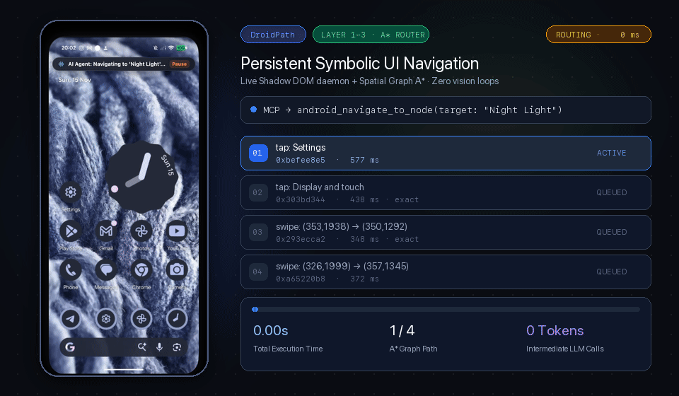
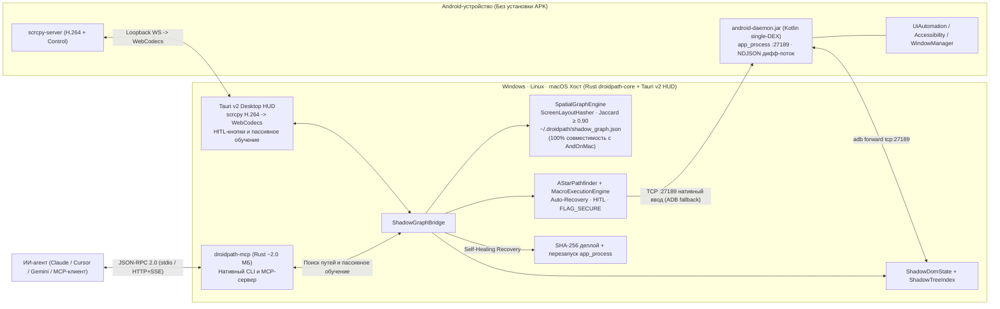

# DroidPath

**Кроссплатформенный персистентный A\* символьный UI-роутер, headless Kotlin Shadow DOM демон, нативный Rust MCP CLI и Tauri v2 Agentic HUD для Android (Windows · Linux · macOS)**

[](./LICENSE)
[](https://github.com/V0val0x/DroidPath)
[](https://github.com/V0val0x/DroidPath/releases)
[](https://github.com/V0val0x/DroidPath/actions/workflows/ci.yml)

[English Version](README.md) | **Русская версия** · [Политика безопасности](SECURITY.md) · [История изменений](CHANGELOG.md)



**DroidPath** избавляет ИИ-агентов от медленных и дорогих циклов *«скриншот → рассуждение VLM → клик»* при автоматизации Android. Вместо анализа скриншотов на каждом шаге DroidPath стримит живой **Shadow DOM** напрямую из Accessibility/Window API, компилирует переходы между экранами в **персистентный Spatial Graph** и проходит многошаговые маршруты детерминированным **алгоритмом A\*** за миллисекунды — с **нулём промежуточных вызовов LLM**.

Построен на **кроссплатформенном Rust (`droidpath-core`)** без JVM, компактном нативном **MCP CLI (`droidpath-mcp`, ~2.0 МБ)**, **Tauri v2 Desktop HUD (`~3 МБ` установщик)** со встроенным зеркалом экрана H.264 -> WebCodecs (Windows, Linux Wayland/X11, macOS) и **нативных установщиках в 1 клик с SHA-256 проверкой** (`install.sh` / `install.ps1`). Формат `~/.droidpath/shadow_graph.json` на **100% совместим** с нативным macOS-приложением [**AndOnMac**](https://github.com/V0val0x/AndOnMac).

---

## Требования

- Устройство **Android 8.0+ (API 26+)** с включённой **Отладкой по USB** или **Беспроводной отладкой** (установка APK и root не требуются).
- Установленные **Android Platform Tools (`adb`)** на компьютере:
  - **macOS:** `brew install android-platform-tools`
  - **Windows:** `winget install Google.PlatformTools`
  - **Linux (Debian/Ubuntu):** `sudo apt install adb`

---

## Быстрый старт (Установка в 1 клик)

### Вариант A: Нативные установщики (`install.sh` / `install.ps1` — рекомендуется, Node.js не требуется)

Скачивает готовый нативный бинарник `droidpath-mcp` и `android-daemon.jar` напрямую из [GitHub Releases](https://github.com/V0val0x/DroidPath/releases), фиксирует тег релиза при редиректах на CDN, проверяет **SHA-256** по `checksums.txt` в режиме fail-closed, разворачивает демон по ADB и автоматически настраивает MCP-клиенты (`cursor`, `claude`, `gemini`, `antigravity` или `all`):

**macOS и Linux:**
```bash
# Установка droidpath-mcp + android-daemon.jar и авто-настройка Cursor, Claude Desktop, Gemini CLI и Antigravity:
curl -fsSL https://raw.githubusercontent.com/V0val0x/DroidPath/main/scripts/install.sh | bash -s -- --configure-mcp all

# Если Android-устройство уже подключено по USB/Wi-Fi, можно сразу развернуть демон:
curl -fsSL https://raw.githubusercontent.com/V0val0x/DroidPath/main/scripts/install.sh | bash -s -- --configure-mcp all --deploy
```

**Windows (PowerShell):**
```powershell
# Установка droidpath-mcp.exe + android-daemon.jar, добавление ~/.droidpath/bin в User PATH и авто-настройка MCP-клиентов:
$env:DROIDPATH_CONFIGURE_MCP="all"; irm https://raw.githubusercontent.com/V0val0x/DroidPath/main/scripts/install.ps1 | iex

# Если Android-устройство уже подключено по USB/Wi-Fi, можно сразу развернуть демон:
$env:DROIDPATH_DEPLOY="1"; $env:DROIDPATH_CONFIGURE_MCP="all"; irm https://raw.githubusercontent.com/V0val0x/DroidPath/main/scripts/install.ps1 | iex

# Или из локального клона с явными параметрами:
.\scripts\install.ps1 -ConfigureMcp all -Deploy
```

После установки `droidpath-mcp` находится в `~/.droidpath/bin/droidpath-mcp` (Windows: `%USERPROFILE%\.droidpath\bin\droidpath-mcp.exe`) рядом с `~/.droidpath/share/android-daemon.jar`:

```bash
droidpath-mcp doctor             # Полная диагностика ADB, устройства, daemon JAR, :27189 и графа
droidpath-mcp deploy             # SHA-256 adb push + adb forward + запуск app_process
droidpath-mcp --stdio            # Запуск stdio JSON-RPC 2.0 MCP-сервера
droidpath-mcp --http --port 8766 # Запуск локального HTTP + SSE MCP-сервера (127.0.0.1:8766/sse)
```

> **Установщики Desktop HUD:** Готовые сборки Tauri v2 Desktop HUD (`.dmg`, `.deb`, `.AppImage`, `.msi`, `.exe`) также приложены к каждому [GitHub Release](https://github.com/V0val0x/DroidPath/releases) с контрольными суммами в `checksums.txt`.

---

### Вариант B: Готовые MCP-конфиги для клиентов (Copy-Paste)

После установки из Варианта A (или сборки из исходников) подключите `droidpath-mcp` в любом MCP-клиенте:

#### Claude Desktop и Cursor (`stdio`)
- **Claude Desktop:** `~/Library/Application Support/Claude/claude_desktop_config.json` (macOS), `%APPDATA%\Claude\claude_desktop_config.json` (Windows), `~/.config/Claude/claude_desktop_config.json` (Linux)
- **Cursor:** `~/.cursor/mcp.json`

```json
{
  "mcpServers": {
    "droidpath": {
      "command": "/Users/<you>/.droidpath/bin/droidpath-mcp",
      "args": ["--stdio", "--daemon-jar", "/Users/<you>/.droidpath/share/android-daemon.jar"]
    }
  }
}
```
> На **Windows** укажите `"command": "C:\\Users\\<you>\\.droidpath\\bin\\droidpath-mcp.exe"` и `"C:\\Users\\<you>\\.droidpath\\share\\android-daemon.jar"`. Если `~/.droidpath/bin` добавлен в `PATH`, достаточно `"command": "droidpath-mcp"` и `"args": ["--stdio"]` — сервер сам найдёт `../share/android-daemon.jar`.

#### Claude Code
```bash
claude mcp add droidpath -- ~/.droidpath/bin/droidpath-mcp --stdio --daemon-jar ~/.droidpath/share/android-daemon.jar
```

#### VS Code / GitHub Copilot (`.vscode/mcp.json`)
```json
{
  "servers": {
    "droidpath": {
      "type": "stdio",
      "command": "droidpath-mcp",
      "args": ["--stdio"]
    }
  }
}
```

#### Gemini CLI (`~/.gemini/settings.json`) и Antigravity (`~/.gemini/antigravity/mcp_config.json`)
```json
{
  "mcpServers": {
    "droidpath": {
      "command": "droidpath-mcp",
      "args": ["--stdio"]
    }
  }
}
```

#### LM Studio / OpenWebUI / MCP Inspector / Локальные ИИ (Loopback HTTP + SSE)
```bash
droidpath-mcp --http --port 8766
# Опциональная Bearer-авторизация: droidpath-mcp --http --port 8766 --auth-token "<секрет>"
```
```json
{
  "mcpServers": {
    "droidpath": {
      "url": "http://127.0.0.1:8766/sse"
    }
  }
}
```
> Слушает строго `127.0.0.1` с проверкой RFC 6454 loopback `Origin`/`Host` и контролем `Content-Length`.

---

### Вариант C: Node.js CLI (`packages/droidpath-cli` — из локального клона / `npm link`)

Сопутствующий Node.js CLI (`packages/droidpath-cli`) добавляет идемпотентную установку правил для агентов (`.cursorrules`, `CLAUDE.md`, `GEMINI.md`, `.agent/rules/droidpath.md`, экспорт схем OpenAI tools и компактного промпта для локальных моделей).

> **Примечание:** пакет `droidpath` ещё не опубликован в реестре `npmjs.org`, поэтому сейчас запускайте его из локального клона или через `npm link` (после публикации в npm также заработает `npx -y droidpath ...`):

```bash
git clone https://github.com/V0val0x/DroidPath.git
cd DroidPath

# Запуск напрямую из клона:
node packages/droidpath-cli/bin/droidpath.mjs start --configure
node packages/droidpath-cli/bin/droidpath.mjs doctor

# Или глобальная привязка локально:
npm --prefix packages/droidpath-cli link
droidpath init --client all       # Настройка Cursor, Claude, Gemini CLI, Antigravity, LM Studio и Local AI + правил агента
droidpath rules --format local    # Вывод компактного промпта для локальных LLM (или --format openai для схем инструментов)
droidpath daemon deploy           # SHA-256 adb push + adb forward + app_process
droidpath mcp --stdio             # Запуск нативного Rust MCP-сервера с авто-деплоем демона
```

---

## Трёхуровневая кроссплатформенная архитектура



1. **Layer 1 — Headless Kotlin Shadow DOM демон (`android-daemon/`):**
   - Автономный **single-DEX JAR (~648 КБ)** (`android-daemon.jar`), запускается через `app_process` без установки APK и выполняет нативный ввод `tap`/`swipe`/`keyevent` через `UiAutomation` напрямую по TCP `:27189` (с zero-fling 120Hz свайпами и авто-fallback на `adb`).
   - Реализует **Privacy by Design** на устройстве: привязывает TCP-сокет строго к локальной петле `127.0.0.1` (`adb forward`) и маскирует `isPassword` / чувствительные поля ввода на `"***"` до отправки по TCP (`:27189`).
   - Стримит полные снимки, инкрементальные NDJSON-диффы, привязку к основному окну приложения (`TYPE_APPLICATION`) под оверлеями `com.android.systemui` и события `SECURE_SCREEN_ACTIVE` / `SECURE_SCREEN_CLEARED` при `FLAG_SECURE` / биометрии по TCP (`:27189`).

2. **Layer 2 — Кроссплатформенное ядро на Rust (`crates/droidpath-core`):**
   - Побитово совместимый FNV-1a 64-bit `ScreenLayoutHasher`: очищает часы, даты, e-commerce токены (`<PRICE>`, `<ETA>`, `<WEIGHT>`), номера банковских карт по алгоритму Луна (`<CARD>`) и контекстные 2FA/OTP-коды (`<OTP>`), декоративные `ImageView` баннеры и системные push-баннеры `com.android.systemui`.
   - `SpatialGraphEngine` строит мультиграф с компактификацией по Жаккару (`>= 0.90`), классификацией опасных рёбер (`HazardousActionClassifier`), деградацией и автоочисткой нестабильных рёбер (`consecutiveFailures`), ациклическим остовным DAG и **100% двусторонней совместимостью `shadow_graph.json`** с Swift `AndOnMac`.
   - **Zero-PII Seed Graph для Android Settings (`SeedGraphCatalog`) и гидратация Seed-to-Real:** поставляется с предзаполненным кросс-девайсным графом на 20 канонических экранов и 19 детерминированных рёбер `com.android.settings` (без координат и PII, с EN/RU и cross-OEM алиасами для Pixel, AOSP, OneUI, HyperOS, OxygenOS). На абсолютно новом телефоне `android_navigate_to_node` строит маршрут с домашнего экрана (`LaunchApp("com.android.settings")`) до *Ночной подсветки*, *Для разработчиков* или *Wi-Fi* с первого запуска и автоматически **гидрирует** пройденные seed-вершины и рёбра в реальные хеши, селекторы и координаты устройства (отключается через `DROIDPATH_DISABLE_SEED_GRAPH=1`).

3. **Layer 3 — A\* роутер, MCP CLI (`crates/droidpath-mcp`) и Tauri v2 Desktop HUD (`apps/droidpath-desktop`):**
   - `AStarPathfinder` + `MacroExecutionEngine` с cold-start исследованием (`android_explore_and_click` / `auto_explore: true`), forward-skip восстановлением (`1 -> 3/4`), размоткой стека экранов `Back-to-Root`, поисковым скроллом `Smart Scroll-to-Selector`, перепланированием после скролла, универсальным закрытием промо-попапов (`UniversalDismissDetector`), смахиванием пуш-уведомлений, HITL-подтверждением опасных действий (`requires_confirmation` / `confirmed: true`) и паузой на `FLAG_SECURE` (таймаут ожидания 60 с по умолчанию).
   - **LLM Onboarding и правила:** включает готовые `.cursorrules`, `CLAUDE.md`, `GEMINI.md` и `docs/system_prompt.md` (идемпотентно устанавливаются через `packages/droidpath-cli` `init` / `rules`), чтобы облачные и локальные модели работали через Shadow DOM и не спамили `android_screenshot`.
   - **Tauri v2 Desktop HUD** объединяет встроенное зеркало экрана (`scrcpy-server` H.264 -> WebCodecs `<canvas>` с автоматическим fallback на `screencap`), трёхцветный **Agentic HUD** (**Красный** — автономная работа, **Жёлтый** — ожидание подтверждения HITL с интерактивными кнопками *Approve / Cancel*, **Синий** — ожидание биометрии / `FLAG_SECURE`) и интерактивный SVG-инспектор графа (с визуальным разделением seed и гидрированных вершин) в одном окне — работает на **Windows, macOS и Linux Wayland/X11** и сохраняет пассивное обучение кликами.

---

## Замер на реальном устройстве (Pixel 10a · `android_navigate_to_node`)

Маршрут: *«Navigate to Show layout bounds»* (`Home > Settings > System > Developer Options > Show Layout Bounds`):

| Метрика | Классический VLM-цикл со скриншотами | **DroidPath A\* + нативный демон (`:27189`)** |
| :--- | :---: | :---: |
| **Промежуточные вызовы LLM** | 7–9 обращений к vision-модели (~15k tok) | **0 вызовов (0 vision-токенов)** |
| **Полное время маршрута** | ~30 000–40 000 мс (оценка) | **2 003 мс** (7 шагов · 1x live) |
| **Обратная связь и ввод** | Тяжёлые PNG (`screencap`) + stateless ADB | Субмиллисекундный Shadow DOM NDJSON + нативный `UiAutomation` `:27189` |

## Сравнение с аналогами

Существующие решения используют stateless ADB-биндинги, что даёт 2–4 секунды задержки на каждое действие и заставляет LLM микроменеджить интерфейс. DroidPath (и [AndOnMac](https://github.com/V0val0x/AndOnMac)) использует персистентный направленный ациклический граф (DAG) и A*-маршрутизацию на Windows, Linux и macOS, снижая latency до `<1s` на клик и полностью снимая нагрузку с LLM при навигации по известным маршрутам.

| Инструмент | Подход к автоматизации | Задержка на шаг | Нагрузка на LLM | Зеркалирование и HUD |
| :--- | :--- | :---: | :--- | :--- |
| **Mobile MCP / Maestro MCP / adbridge** | Stateless-обёртки над ADB / `uiautomator` | 2–4 с | LLM планирует каждый клик и свайп | Нет |
| **Appium / CursorTouch** | WebDriver-сессии или циклы по скриншотам | 2–5 с | Частые запросы к модели и опрос DOM | Внешнее / VNC |
| **DroidPath (Rust + Tauri v2 / AndOnMac)** | Персистентный DAG + A*-роутер + Shadow DOM демон | `<1s` / шаг | `0` промежуточных вызовов на известных маршрутах | Tauri v2 WebCodecs / 120Hz Metal + 3-цветный HUD |

---

## Сборка из исходников

Требования: Rust (`stable`), `adb`, Node.js 18+ (для CLI и фронтенда Tauri), JDK 17 (только для пересборки `android-daemon.jar`).

```bash
git clone https://github.com/V0val0x/DroidPath.git
cd DroidPath

# 1. Тесты Rust ядра и MCP-сервера
cargo test -p droidpath-core -p droidpath-mcp

# 2. Сборка нативного release-бинарника droidpath-mcp (~2.0 МБ, без JVM)
cargo build --release -p droidpath-mcp

# 3. Тесты Node.js CLI и установщиков
npm --prefix packages/droidpath-cli test

# 4. Запуск / сборка кроссплатформенного Tauri v2 Desktop HUD
cd apps/droidpath-desktop
npm install
npm run tauri dev      # или: npm run tauri build

# 5. (Опционально) Пересборка Kotlin single-DEX android-daemon.jar
./android-daemon/scripts/build-dex.sh
npm --prefix packages/droidpath-cli run sync-daemon
```

---

## Доступные MCP-инструменты (9 инструментов)

| Инструмент | Описание |
| :--- | :--- |
| `android_navigate_to_node` | A\* маршрутизация по сохранённым и seed-экранам к целевому тексту, `resource-id`, пакету или каноническому хешу (`0x...`), включая cold-start `auto_explore: true` и HITL `confirmed: true` |
| `android_explore_and_click` | Dynamic Auto-Explore без предварительной записи графа: скоринг живого Shadow DOM, поисковый скролл со сменой направления у дна, клик и достраивание рёбер DAG на лету (либо топ-20 PII-очищенных `candidates`) |
| `android_get_ui_tree` | Чтение дерева UI из быстрого Shadow DOM потока за `<1ms` (с fallback на `uiautomator`) |
| `android_graph_stats` | Статистика графа: число вершин/рёбер (`seed_vertex_count`, `hydrated_vertex_count`), текущий хеш, состояние демона, путь сохранения |
| `android_list_devices` | Список подключённых Android-устройств по USB и Wi-Fi ADB |
| `android_tap_element` | Клик по `(x, y)` или семантике (`text` / `resource_id` / `content_desc`) с записью в граф |
| `android_swipe` | Свайп `(x1, y1) -> (x2, y2)` с обучением ребра графа |
| `android_type_text` | Ввод ASCII и Unicode/кириллического текста (через безопасную вставку буфера обмена) в активное поле |
| `android_keyevent` | Отправка системных кнопок (`HOME`, `BACK`, `ENTER`, `RECENTS`/`APP_SWITCH`, `VOLUME_UP`, `VOLUME_DOWN`, `POWER`) |

---

## Безопасность, приватность и SHA-256 целостность релизов

Подробная политика безопасности и порядок сообщений об уязвимостях: [SECURITY.md](./SECURITY.md).

- **Zero-PII на устройстве и на диске:** поля паролей маскируются в `***` внутри `android-daemon` до стриминга; номера карт (проверка Луна) и 2FA/OTP-коды очищаются в `<CARD>` / `<OTP>` до хеширования и записи в `shadow_graph.json`.
- **Строго Loopback (`127.0.0.1`):** и `android-daemon` (`127.0.0.1:27189`), и `droidpath-mcp --http` (`127.0.0.1:8766`) слушают только `127.0.0.1`, проверяют RFC 6454 loopback `Origin`/`Host` и `Content-Length` (защита от DNS rebinding и CSRF) и поддерживают `Authorization: Bearer <token>`.
- **Обязательные шлюзы HITL и биометрии:** необратимые действия (`Pay`, `Buy`, `Transfer`, `Send`, `Delete`, `Factory Reset`) останавливаются со статусом `requires_confirmation` до явного `confirmed: true`; экраны `FLAG_SECURE` / биометрии немедленно ставят автоматизацию на паузу (`secure_screen_active`).
- **Проверка SHA-256 релизов:** каждый GitHub Release публикует `checksums.txt`; `install.sh`, `install.ps1` и `packages/droidpath-cli` проверяют SHA-256 в режиме fail-closed с 2-hop фиксацией CDN redirect URL и атомарной установкой.

---

## Нативный компаньон для macOS

- [**AndOnMac**](https://github.com/V0val0x/AndOnMac) — нативное macOS-приложение зеркалирования 120Hz (VideoToolbox + Metal) на Swift с полной 100% совместимостью формата `shadow_graph.json`.

## Лицензия

MIT License © 2026 Kirill Zaitsev. См. [LICENSE](./LICENSE).
