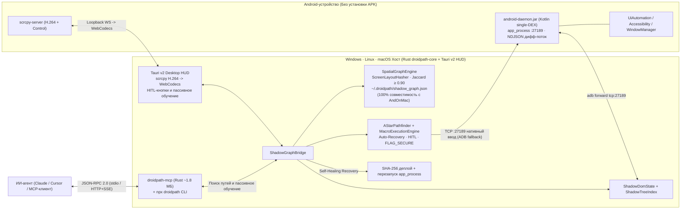

# DroidPath

**Кроссплатформенный персистентный A\* символьный UI-роутер, headless Kotlin Shadow DOM демон, нативный Rust MCP CLI и Tauri v2 Agentic HUD для Android (Windows · Linux · macOS)**

[](./LICENSE)
[](https://github.com/V0val0x/DroidPath)
[](https://github.com/V0val0x/DroidPath/releases)
[](https://github.com/V0val0x/DroidPath/actions/workflows/ci.yml)

[English Version](README.md) | **Русская версия**


**DroidPath** избавляет ИИ-агентов от медленных и дорогих циклов *«скриншот → рассуждение VLM → клик»* при автоматизации Android. Вместо анализа скриншотов на каждом шаге DroidPath стримит живой **Shadow DOM** напрямую из Accessibility/Window API, компилирует переходы между экранами в **персистентный Spatial Graph** и проходит многошаговые маршруты детерминированным **алгоритмом A\*** за миллисекунды — с **нулём промежуточных вызовов LLM**.

Версия 2.0 перенесена на **кроссплатформенный Rust (`droidpath-core`)** без JVM, компактный нативный **MCP CLI (`droidpath-mcp`, ~1.8 МБ)**, **Tauri v2 Desktop HUD (`~3.9 МБ`)** со встроенным зеркалом экрана H.264 -> WebCodecs (Windows, Linux Wayland/X11, macOS) и **установку в 1 клик** (`npx droidpath`, `install.sh`, `install.ps1`). Формат `~/.droidpath/shadow_graph.json` на **100% совместим** с нативным macOS-приложением [**AndOnMac**](https://github.com/V0val0x/AndOnMac).

---

## Установка в 1 клик (Zero-Friction Onboarding)

### Вариант A: `npx droidpath` (Windows · Linux · macOS)

Содержит встроенный `android-daemon.jar` — одной командой пушит демон с SHA-256 кешированием (`adb push`), пробрасывает порт (`adb forward`), запускает `app_process` и автоматически прописывает MCP в Cursor, Claude Desktop/Code, Gemini CLI, Antigravity, LM Studio и локальных ИИ-рантаймах (а также идемпотентные правила агента по умолчанию, либо пропуск через `--no-rules`):

```bash
# Старт в 1 клик: деплой демона + авто-настройка MCP и правил (Cursor / Claude / Gemini / Antigravity)
npx droidpath start --configure

# Отдельные команды:
npx droidpath init --client all       # Авто-настройка Cursor, Claude, Gemini CLI, Antigravity, локальных ИИ и правил агента
npx droidpath rules --format local    # Установка .cursorrules/CLAUDE.md/GEMINI.md или экспорт промпта для локальных LLM
npx droidpath daemon deploy           # SHA-256 adb push + adb forward + app_process
npx droidpath mcp --stdio             # Запуск нативного Rust MCP-сервера с авто-деплоем демона
npx droidpath doctor                  # Полная диагностика ADB, устройства, демона и графа
```

### Вариант B: Установщики без Node.js (`install.sh` / `install.ps1`)

**macOS и Linux:**
```bash
curl -fsSL https://raw.githubusercontent.com/V0val0x/DroidPath/main/scripts/install.sh | bash -s -- --deploy --configure-mcp all
```

**Windows (PowerShell):**
```powershell
irm https://raw.githubusercontent.com/V0val0x/DroidPath/main/scripts/install.ps1 | iex
# Или локально с авто-деплоем и настройкой MCP:
.\scripts\install.ps1 -Deploy -ConfigureMcp all
```

---

## Трёхуровневая кроссплатформенная архитектура



1. **Layer 1 — Headless Kotlin Shadow DOM демон (`android-daemon/`):**
   - Автономный **single-DEX JAR (646 КБ)** (`android-daemon.jar`), запускается через `app_process` без установки APK и выполняет нативный ввод `tap`/`swipe`/`keyevent` через `UiAutomation` напрямую по TCP `:27189` (с zero-fling 120Hz свайпами и авто-fallback на `adb`).
   - Реализует **Privacy by Design** на устройстве: привязывает TCP-сокет строго к локальной петле `127.0.0.1` (`adb forward`) и маскирует `isPassword` / чувствительные поля ввода на `"***"` до отправки по TCP (`:27189`).
   - Стримит полные снимки, инкрементальные NDJSON-диффы, привязку к основному окну приложения (`TYPE_APPLICATION`) под оверлеями `com.android.systemui` и события `SECURE_SCREEN_ACTIVE` / `SECURE_SCREEN_CLEARED` при `FLAG_SECURE` / биометрии по TCP (`:27189`).

2. **Layer 2 — Кроссплатформенное ядро на Rust (`crates/droidpath-core`):**
   - Побитово совместимый FNV-1a 64-bit `ScreenLayoutHasher`: очищает часы, даты, e-commerce токены (`<PRICE>`, `<ETA>`, `<WEIGHT>`), номера банковских карт по алгоритму Луна (`<CARD>`) и контекстные 2FA/OTP-коды (`<OTP>`), декоративные `ImageView` баннеры и системные push-баннеры `com.android.systemui`.
   - `SpatialGraphEngine` строит мультиграф с компактификацией по Жаккару (`>= 0.90`), классификацией опасных рёбер (`HazardousActionClassifier`), деградацией и автоочисткой нестабильных рёбер (`consecutiveFailures`), ациклическим остовным DAG и **100% двусторонней совместимостью `shadow_graph.json`** с Swift `AndOnMac`.

3. **Layer 3 — A\* роутер, MCP CLI (`crates/droidpath-mcp`) и Tauri v2 Desktop HUD (`apps/droidpath-desktop`):**
   - `AStarPathfinder` + `MacroExecutionEngine` с cold-start исследованием (`android_explore_and_click` / `auto_explore: true`), forward-skip восстановлением (`1 -> 3/4`), размоткой стека экранов `Back-to-Root`, поисковым скроллом `Smart Scroll-to-Selector`, перепланированием после скролла, универсальным закрытием промо-попапов (`UniversalDismissDetector`), смахиванием пуш-уведомлений, HITL-подтверждением опасных действий (`requires_confirmation` / `confirmed: true`) и паузой на `FLAG_SECURE` (таймаут ожидания 60 с по умолчанию).
   - **LLM Onboarding и правила:** включает готовые `.cursorrules`, `CLAUDE.md`, `GEMINI.md` и `docs/system_prompt.md` (идемпотентно устанавливаются через `npx droidpath init` / `npx droidpath rules` или пропускаются флагом `--no-rules`), чтобы облачные и локальные модели работали через Shadow DOM и не спамили `android_screenshot`.
   - **Tauri v2 Desktop HUD** объединяет встроенное зеркало экрана (`scrcpy-server` H.264 -> WebCodecs `<canvas>` с автоматическим fallback на `screencap`), трёхцветный **Agentic HUD** (**Красный** — автономная работа, **Жёлтый** — ожидание подтверждения HITL с интерактивными кнопками *Approve / Cancel*, **Синий** — ожидание биометрии / `FLAG_SECURE`) и интерактивный SVG-инспектор графа в одном окне — работает на **Windows, macOS и Linux Wayland/X11** и сохраняет пассивное обучение кликами.

---

## Замер на реальном устройстве (Pixel 10a · `android_navigate_to_node`)

Маршрут: *«Navigate to Show layout bounds»* (`Home > Settings > System > Developer Options > Show Layout Bounds`):

| Метрика | Классический VLM-цикл со скриншотами | **DroidPath A\* + нативный демон (`:27189`)** |
| :--- | :---: | :---: |
| **Промежуточные вызовы LLM** | 7–9 обращений к vision-модели (~15k tok) | **0 вызовов (0 vision-токенов)** |
| **Полное время маршрута** | ~30 000–40 000 мс (оценка) | **2 003 мс** (7 шагов · 1x live) |
| **Обратная связь и ввод** | Тяжёлые PNG (`screencap`) + stateless ADB | Субмиллисекундный Shadow DOM NDJSON + нативный `UiAutomation` `:27189` |

## Comparison with Alternatives

Существующие решения используют stateless ADB-биндинги, что даёт 2–4 секунды задержки на каждое действие и заставляет LLM микроменеджить интерфейс. DroidPath (и [AndOnMac](https://github.com/V0val0x/AndOnMac)) использует персистентный направленный ациклический граф (DAG) и A*-маршрутизацию на Windows, Linux и macOS, снижая latency до `<1s` на клик и полностью снимая нагрузку с LLM при навигации по известным маршрутам.

| Инструмент | Подход к автоматизации | Задержка на шаг | Нагрузка на LLM | Зеркалирование и HUD |
| :--- | :--- | :---: | :--- | :--- |
| **Mobile MCP / Maestro MCP / adbridge** | Stateless-обёртки над ADB / `uiautomator` | 2–4 с | LLM планирует каждый клик и свайп | Нет |
| **Appium / CursorTouch** | WebDriver-сессии или циклы по скриншотам | 2–5 с | Частые запросы к модели и опрос DOM | Внешнее / VNC |
| **DroidPath (Rust + Tauri v2 / AndOnMac)** | Персистентный DAG + A*-роутер + Shadow DOM демон | `<1s` / шаг | `0` промежуточных вызовов на известных маршрутах | Tauri v2 WebCodecs / 120Hz Metal + 3-цветный HUD |

---

## Сборка из исходников

Требования: Rust (`stable`), `adb`, Node.js 18+ (для CLI и фронтенда Tauri), JDK 17 (только для пересборки `android-daemon.jar`).

```bash
git clone https://github.com/V0val0x/DroidPath.git
cd DroidPath

# 1. Тесты Rust ядра и MCP-сервера
cargo test -p droidpath-core -p droidpath-mcp

# 2. Сборка нативного release-бинарника droidpath-mcp (~1.8 МБ, без JVM)
cargo build --release -p droidpath-mcp

# 3. Тесты Node.js 1-клик CLI
npm --prefix packages/droidpath-cli test

# 4. Запуск / сборка кроссплатформенного Tauri v2 Desktop HUD
cd apps/droidpath-desktop
npm install
npm run tauri dev      # или: npm run tauri build

# 5. (Опционально) Пересборка Kotlin single-DEX android-daemon.jar
./android-daemon/scripts/build-dex.sh
npm --prefix packages/droidpath-cli run sync-daemon
```

---

## Доступные MCP-инструменты

| Инструмент | Описание |
| :--- | :--- |
| `android_navigate_to_node` | A\* маршрутизация к целевому тексту, `resource-id`, пакету или каноническому хешу (`0x...`), включая cold-start `auto_explore: true` и HITL `confirmed: true` |
| `android_explore_and_click` | Dynamic Auto-Explore без предварительной записи графа: скоринг живого Shadow DOM, поисковый скролл со сменой направления у дна, клик и достраивание рёбер DAG на лету (либо топ-20 PII-очищенных `candidates`) |
| `android_get_ui_tree` | Чтение дерева UI из быстрого Shadow DOM потока (с fallback на `uiautomator`) |
| `android_graph_stats` | Статистика графа: число вершин/рёбер, текущий хеш, состояние демона, путь сохранения |
| `android_list_devices` | Список подключённых Android-устройств по USB и Wi-Fi ADB |
| `android_tap_element` | Клик по `(x, y)` или семантике (`text` / `resource_id` / `content_desc`) с записью в граф |
| `android_swipe` | Свайп `(x1, y1) -> (x2, y2)` с обучением ребра графа |
| `android_type_text` | Ввод ASCII и Unicode текста в активное поле |
| `android_keyevent` | Отправка системных кнопок (`HOME`, `BACK`, `ENTER`, `APP_SWITCH`, `POWER`) |

---

## Нативный компаньон для macOS

- [**AndOnMac**](https://github.com/V0val0x/AndOnMac) — нативное macOS-приложение зеркалирования 120Hz (VideoToolbox + Metal) на Swift с полной 100% совместимостью формата `shadow_graph.json`.

## Лицензия

MIT License © 2026 Kirill Zaitsev. См. [LICENSE](./LICENSE).
