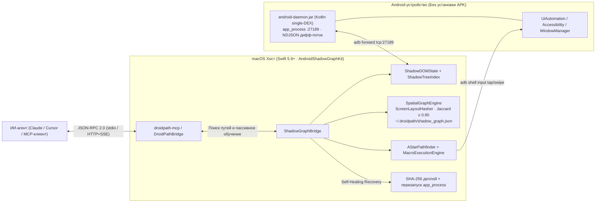

# DroidPath

**Персистентный A\* символьный UI-роутер, headless Kotlin Shadow DOM демон и автономный MCP-мост для Android**

[](./LICENSE)
[](https://github.com/V0val0x/DroidPath)
[](https://github.com/V0val0x/DroidPath/releases)
[](https://github.com/V0val0x/DroidPath/actions/workflows/ci.yml)

[English Version](README.md) | **Русская версия**


**DroidPath** избавляет ИИ-агентов от медленных и дорогих циклов *«скриншот → рассуждение VLM → клик»* при автоматизации Android. Вместо анализа скриншотов на каждом шаге DroidPath стримит живой **Shadow DOM** напрямую из Accessibility/Window API, компилирует переходы между экранами в **персистентный Spatial Graph** и проходит многошаговые маршруты детерминированным **алгоритмом A\*** за миллисекунды — с **нулём промежуточных вызовов LLM**.

---

## Трёхуровневая архитектура



1. **Layer 1 — Headless Kotlin Shadow DOM демон (`android-daemon/`):**
   - Собирается в автономный **single-DEX JAR (631 КБ)** (`android-daemon.jar`), запускается напрямую через `app_process` — не требует установки APK.
   - Стримит полные снимки и компактные NDJSON-диффы по TCP (`:27189`) с дебаунсингом событий, контролем глубины дерева и heartbeat/watchdog.
   - Деплоится идемпотентно по SHA-256 (`DroidPathManager` / `deploy.sh`) и автоматически перезапускается механизмом Self-Healing при обрыве процесса.

2. **Layer 2 — Live Shadow DOM и персистентный Spatial Graph (`AndroidShadowGraphKit`):**
   - `ScreenLayoutHasher` очищает динамические часы (`12:34`) и даты, чтобы возврат на главный экран или в Настройки давал стабильный хеш состояния.
   - `SpatialGraphEngine` строит ориентированный мультиграф экранов (`vertices`) и жестов (`edges`), схлопывает дубликаты по коэффициенту Жаккара (`>= 0.90`) и сохраняет граф в `~/.droidpath/shadow_graph.json`.

3. **Layer 3 — Персистентный A\* роутер и автономный MCP-мост (`DroidPathBridge` + `droidpath-mcp`):**
   - `AStarPathfinder` + `BinaryHeapPriorityQueue` находит кратчайший маршрут до целевого текста, `resource-id`, пакета или хеша экрана.
   - `MacroExecutionEngine` отправляет жесты по ADB, проверяет подтверждение перехода через живой Shadow DOM на каждом шаге и выдаёт структурированный `PathDeviationError` при неожиданных диалогах или таймаутах.

---

## Замер на реальном устройстве (Pixel 10a · `android_navigate_to_node`)

Задача: *«Открыть экран Night Light»* с рабочего стола:

| Метрика | Классический VLM-цикл со скриншотами | **DroidPath A\* Router** |
| :--- | :---: | :---: |
| **Промежуточные вызовы LLM** | 4–5 обращений к vision-модели | **0 вызовов** |
| **Полное время маршрута** | ~12 000–25 000 мс | **1 863 мс** (4 шага) |
| **Обратная связь интерфейса** | Тяжёлые PNG (`screencap`) | Субмиллисекундные Shadow DOM кадры |

| Исполнение A\* маршрута поверх 120Hz HUD |
| :---: |
|  |

---

## Быстрый старт

### 1. Сборка `droidpath-mcp` и `android-daemon.jar`

Требования: macOS 14+, Swift 5.9+, `adb` (`brew install android-platform-tools`), JDK 17 (при пересборке `android-daemon.jar` из Kotlin).

```bash
git clone https://github.com/V0val0x/DroidPath.git
cd DroidPath

# Сборка single-DEX Kotlin-демона
./android-daemon/scripts/build-dex.sh

# Запуск Swift и Kotlin тестов
swift test
./android-daemon/gradlew -p android-daemon test

# Сборка release-бинарника CLI
swift build -c release
```

Либо скачайте готовые `droidpath-mcp` и `android-daemon.jar` из [**GitHub Releases**](https://github.com/V0val0x/DroidPath/releases).

### 2. Настройка для Claude Desktop / Cursor (`stdio`)

```json
{
  "mcpServers": {
    "droidpath": {
      "command": "/path/to/droidpath-mcp",
      "args": ["--stdio", "--daemon-jar", "/path/to/android-daemon.jar"]
    }
  }
}
```

Либо запуск локального HTTP/SSE MCP-сервера (`127.0.0.1:8766`):

```bash
droidpath-mcp --http --port 8766 --daemon-jar ./android-daemon/build/dist/android-daemon.jar
```

### 3. Подключение через Swift Package Manager

```swift
dependencies: [
    .package(url: "https://github.com/V0val0x/DroidPath.git", from: "1.0.0")
]
```

Добавьте `"AndroidShadowGraphKit"` или `"DroidPathBridge"` в зависимости вашего таргета.

---

## Доступные MCP-инструменты

| Инструмент | Описание |
| :--- | :--- |
| `android_navigate_to_node` | A\* маршрутизация к целевому тексту, `resource-id`, пакету или каноническому хешу (`0x...`) |
| `android_get_ui_tree` | Чтение дерева UI из быстрого Shadow DOM потока (с fallback на `uiautomator`) |
| `android_graph_stats` | Статистика графа: число вершин/рёбер, текущий хеш, состояние демона, путь сохранения |
| `android_list_devices` | Список подключённых Android-устройств по USB и Wi-Fi ADB |
| `android_tap_element` | Клик по `(x, y)` или семантике (`text` / `resource_id` / `content_desc`) с записью в граф |
| `android_swipe` | Свайп `(x1, y1) -> (x2, y2)` с обучением ребра графа |
| `android_type_text` | Ввод текста в активное поле |
| `android_keyevent` | Отправка системных кнопок (`HOME`, `BACK`, `ENTER`, `APP_SWITCH`, `POWER`) |

---

## Модульная экосистема

Часть открытого стека автоматизации macOS ↔ Android вместе с [**AndOnMac**](https://github.com/V0val0x/AndOnMac):

- [**AndOnMac**](https://github.com/V0val0x/AndOnMac) — нативное приложение зеркалирования Android до 120 FPS (VideoToolbox + Metal) с живым Agentic HUD
- [**AndroidMCPKit**](https://github.com/V0val0x/AndroidMCPKit) — Visual-to-MCP студия макросов и 3-уровневый Vision OCR Self-Healing
- [**MetalScrcpyKit**](https://github.com/V0val0x/MetalScrcpyKit) — zero-copy VideoToolbox H.264/HEVC декодер и `CAMetalLayer` рендерер
- [**ADBConnectKit**](https://github.com/V0val0x/ADBConnectKit) — Swift ADB SDK без внешних зависимостей (USB, QR-сопряжение, Hotspot bypass)
- [**VisionScreenRecallKit**](https://github.com/V0val0x/VisionScreenRecallKit) — локальный Apple Vision OCR и SQLite FTS5 память экрана

---

## Лицензия

MIT License © 2026 Kirill Zaitsev. См. [LICENSE](./LICENSE).
